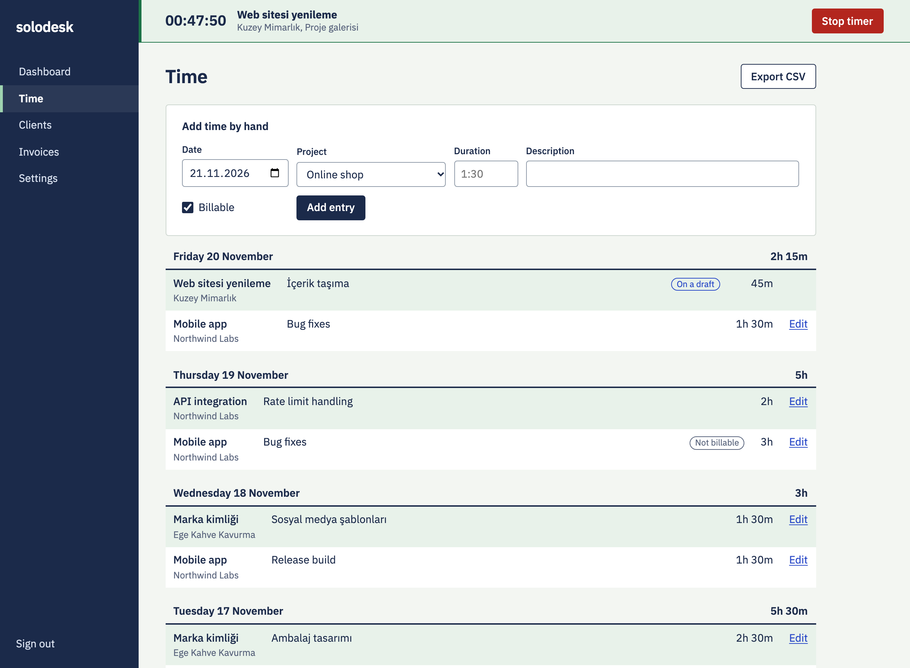
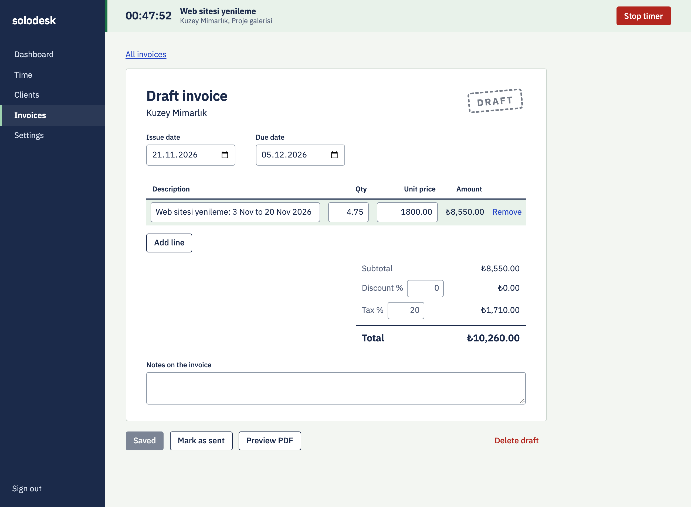

# solodesk

A self-hosted back office for freelancers and tiny studios: clients, projects, a timer, and
numbered PDF invoices in TRY, USD, EUR or GBP. It runs as one small app on your own machine,
with your books in a single SQLite file that never leaves it.


## Quickstart

You need Python 3.12+, Node 22+ and `make`.

```sh
git clone https://github.com/Habibeyilmazz/solodesk.git
cd solodesk
make seed   # optional: fill the empty database with demo data
make run    # installs what is missing, builds the UI, serves http://localhost:4150
```

The first run copies `.env.example` to `.env`. Sign in with the password in that file
(`change-me-please`) and change it before you put real data in.

With Docker instead:

```sh
cp .env.example .env          # then edit SOLODESK_PASSWORD
docker compose up -d          # http://localhost:4150
docker compose run --rm solodesk python -m solodesk.seed   # optional demo data
```

## What it does

- **Clients and projects.** Each client has an invoice currency; each project has an hourly rate.
- **Time tracking.** A timer bar on every page (start, stop, one timer at a time) and manual
  entries typed as `1:30`, `1.5` or `90m`. Entries can be marked not billable.
- **Invoices.** Build a draft from a client's unbilled time (one line per project), from fixed
  line items, or both. Percentage discount and tax, totals updated as you type.
- **Sequential numbers.** An invoice gets its number (`INV-0001`, prefix configurable) when you
  mark it sent, so deleted drafts never leave a gap. Sent invoices are locked.
- **Status flow.** Draft, sent, paid, with overdue shown automatically once the due date passes.
  A payment marked by mistake can be undone.
- **PDF export** with your business details, the client's, and Turkish characters and ₺ intact
  ([sample](docs/sample-invoice.pdf)).
- **Dashboard.** Revenue per month for the last 12 months, unpaid and overdue totals with the
  invoices to chase, hours this week, and top clients. Shown per currency; nothing is converted.
- **CSV export** of invoices and time entries.
- **Single-user sign-in** with a password from the environment.

| Time log | Invoice |
| --- | --- |
|  |  |
|  |  |

All screenshots are of the running app with the demo data from `make seed`.

## How it works

One FastAPI process serves a JSON API under `/api` and the built React app everywhere else.
Data lives in `data/solodesk.db` (SQLite). Back it up by copying that file.

```
backend/solodesk/   FastAPI app: models, routers, money arithmetic, PDF, seed script
backend/tests/      pytest API and unit tests
frontend/src/       React + TypeScript UI
frontend/e2e/       Playwright smoke test of the main flow
```

**Money is never a float.** Amounts are integers in minor units (kuruş, cents, pence),
quantities are integer hundredths and rates are basis points. Rounding happens once per line
and once each for discount and tax, half up. The browser's live preview uses the same integer
arithmetic as the server (`frontend/src/lib/money.ts` mirrors `backend/solodesk/money.py`), and
amounts typed into forms are parsed from their digits rather than through `parseFloat`.

**Tracked time becomes hours with two decimals.** 110 minutes is billed as 1.83 h, so quantity
times rate equals the amount printed on the invoice.

**Sign-in.** The password comes from `SOLODESK_PASSWORD` and is hashed with scrypt at startup;
set `SOLODESK_PASSWORD_HASH` instead to keep the plain password out of the environment
(`python -m solodesk.auth` prints a hash). Signing in creates a server-side session stored as a
SHA-256 hash, sent in an `HttpOnly`, `SameSite=Strict` cookie. Every write must also carry the
session's CSRF token in an `X-CSRF-Token` header. Five failed logins from one address lock that
address out for 15 minutes.

**API docs.** Interactive OpenAPI docs are at `/api/docs` on a running instance.

## Configuration

| Variable | Meaning |
| --- | --- |
| `SOLODESK_PASSWORD` | The sign-in password, at least 8 characters. Required unless a hash is set. |
| `SOLODESK_PASSWORD_HASH` | A hash from `python -m solodesk.auth`, used instead of the password. Single-quote it in `.env`. |
| `SOLODESK_DATA_DIR` | Folder for the SQLite database. Default `data`. |
| `SOLODESK_COOKIE_SECURE` | Set to `1` when serving over HTTPS so the cookie is marked `Secure`. |
| `TZ` | Time zone that decides when "today" starts for timers and due dates. |

solodesk listens on `127.0.0.1` by default. To reach it from elsewhere, put a reverse proxy
with TLS in front and set `SOLODESK_COOKIE_SECURE=1`.

## Development

```sh
make dev    # API with reload on :4150, UI with hot reload on http://localhost:4151
make test   # pytest, frontend unit tests, typecheck
make lint   # ruff
make e2e    # Playwright smoke test (once: cd frontend && npx playwright install chromium)
```

CI runs all of these on every push, then builds the Docker image and checks that the
container starts and serves the app.

## Roadmap

Not built yet:

- Fixed-amount discounts and per-line tax rates
- Freezing client and business details on a sent invoice (the PDF currently prints the current ones)
- Credit notes or voiding a sent invoice
- Adding more tracked time to an existing draft, and per-entry detail lines
- Expenses and recurring invoices
- Emailing invoices from the app
- Schema migrations (0.1 creates tables on first start and has no upgrade path yet)
- A Turkish interface and locale-specific number formats
- Currency conversion for combined totals

## License

MIT, see [LICENSE](LICENSE). Invoice PDFs embed DejaVu Sans, which ships under its own
permissive licence in `backend/solodesk/fonts/`.
