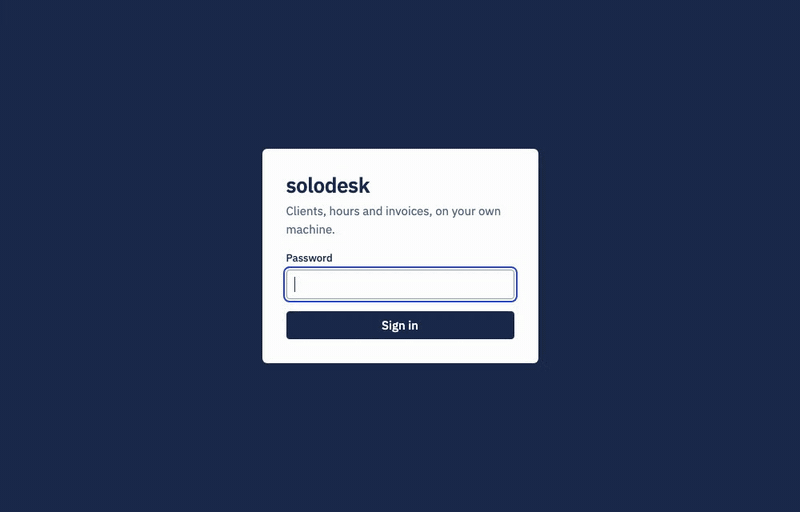
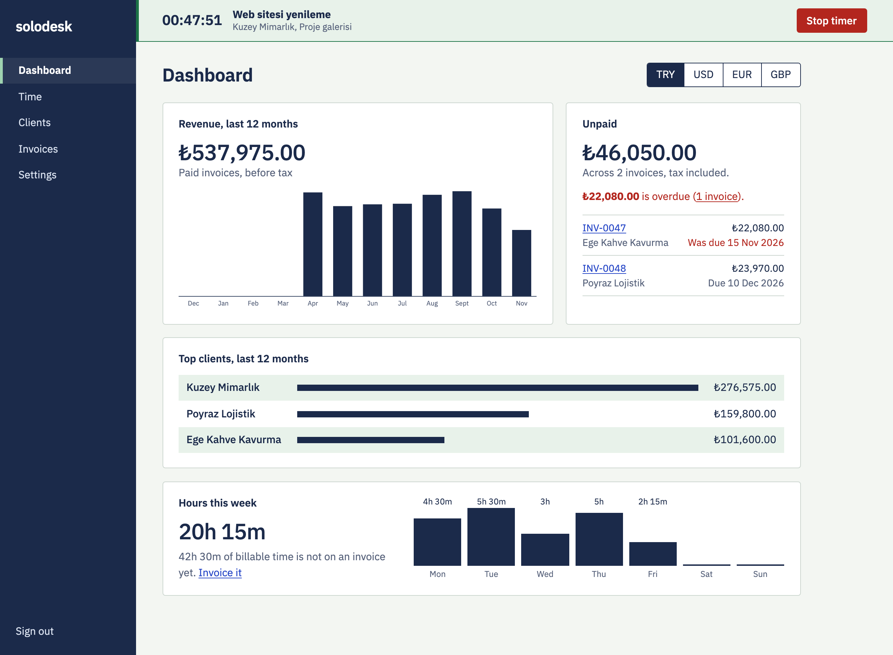
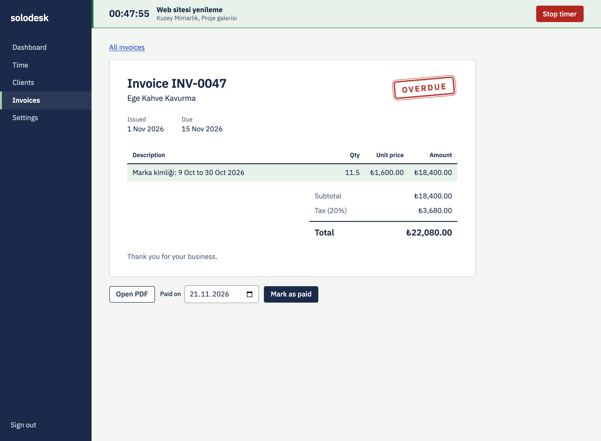
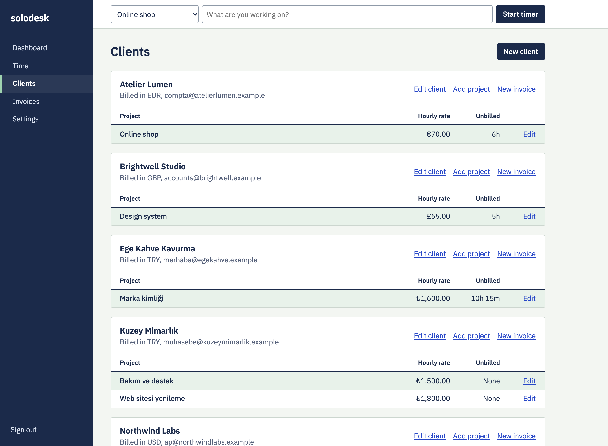
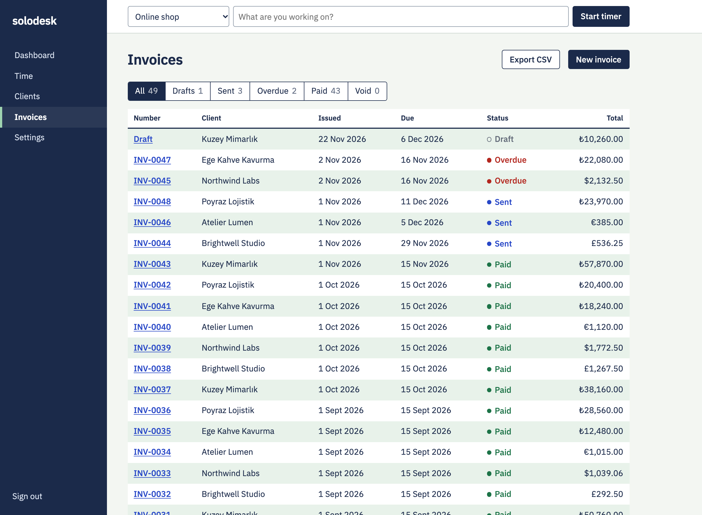
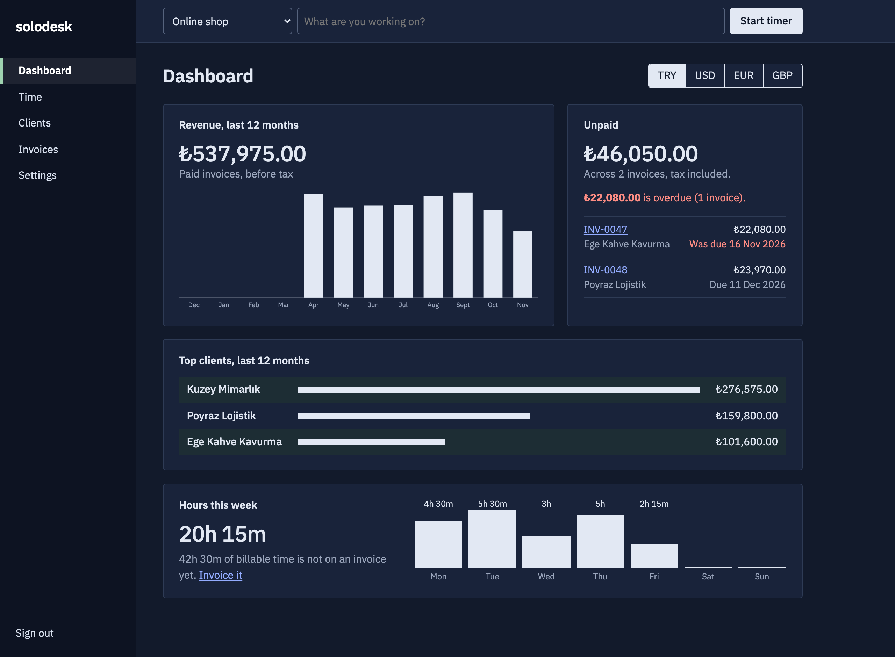
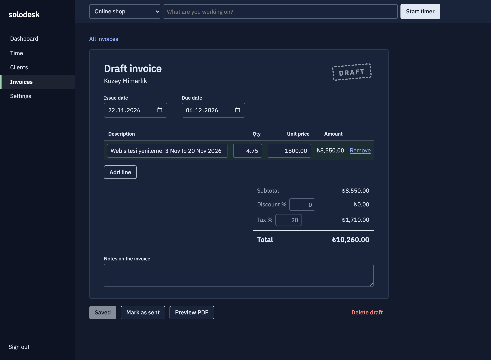
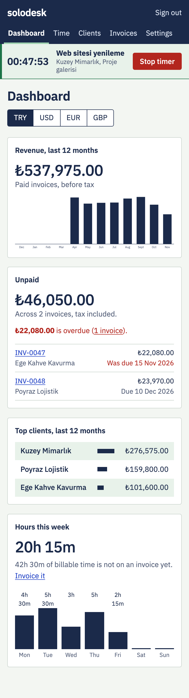
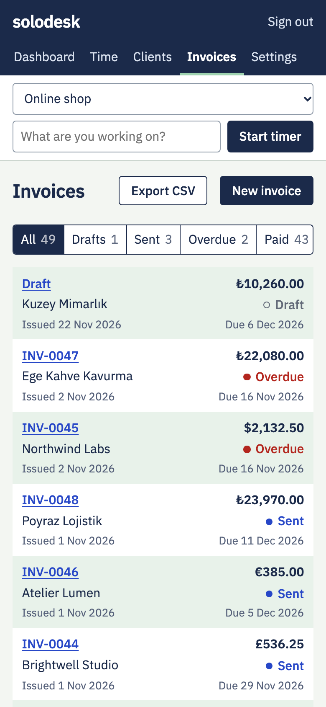

# solodesk

A self-hosted back office for freelancers and tiny studios: clients, projects, a timer, and
numbered PDF invoices in TRY, USD, EUR or GBP. It runs as one small app on your own machine,
with your books in a single SQLite file that never leaves it.



The recording above is the real app on an empty database (`frontend/scripts/demo.mjs`).



## Quickstart

You need Python 3.12+, Node 22.12+ (22.18+ for `make test`) and `make`.

```sh
git clone https://github.com/Habibeyilmazz/solodesk.git
cd solodesk
make seed   # optional: fill the empty database with demo data
make run    # installs what is missing, builds the UI, serves http://localhost:4150
```

The first run copies `.env.example` to `.env`. Sign in with the password in that file
(`change-me-please`). Before you put real data in, change `SOLODESK_PASSWORD` in `.env` and
start solodesk again: that also signs out every session opened with the old password. Then
fill in your business details under Settings; they are the header of every invoice.

If `python3` on your machine is older than 3.12 (macOS ships 3.9), `make` stops and says so.
Name a newer one: `make run PYTHON=python3.12`.

With Docker instead:

```sh
cp .env.example .env          # then edit SOLODESK_PASSWORD
docker compose up -d          # http://localhost:4150
docker compose run --rm solodesk python -m solodesk.seed   # optional demo data
```

After pulling a newer version, rebuild with `docker compose up -d --build`.

## What it does

- **Clients and projects.** Each client has an invoice currency; each project has an hourly rate.
- **Time tracking.** A timer bar on every page (start, stop, one timer at a time) and manual
  entries typed as `1:30`, `1.5` or `90m`. Entries can be marked not billable.
- **Invoices.** Build a draft from a client's unbilled time (one line per project), from fixed
  line items, or both. Percentage discount and tax, totals updated as you type.
- **Sequential numbers.** An invoice gets its number (`INV-0001`, prefix configurable) when you
  mark it sent, so deleted drafts never leave a gap. Sent invoices are locked, and their PDF
  keeps printing your details and the client's as they were on the day it was sent.
- **Status flow.** Draft, sent, paid, with overdue shown automatically once the due date passes.
  A payment marked by mistake can be undone.
- **Voiding.** A sent invoice that should not have gone out (wrong hours, wrong client, a job
  that was called off) can be voided. It keeps its number, so the sequence has no gap, and
  stays in the list, the CSV and its PDF marked void. It stops counting as unpaid or overdue
  on the dashboard, and its tracked time becomes unbilled again, ready for a corrected
  invoice. Voiding is final; a paid invoice has to be marked unpaid first.
- **PDF export** with your business details, the client's, and Turkish characters and ₺ intact
  ([sample](docs/sample-invoice.pdf)). The bundled font has no Chinese, Japanese or Korean
  glyphs, so text in those scripts will not print.
- **Dashboard.** Revenue per month for the last 12 months, unpaid and overdue totals with the
  invoices to chase, hours this week, and top clients. Shown per currency; nothing is converted.
- **CSV export** of invoices and time entries.
- **Single-user sign-in** with a password from the environment.
- **Light and dark** follow your system setting. On a phone, the invoice list, time log and
  line editor turn into stacked rows instead of scrolling sideways.

| Time log | Invoice |
| --- | --- |
|  |  |
|  |  |
|  |  |
|  |   |

All screenshots are of the running app with the demo data from `make seed`.

## How it works

One FastAPI process serves a JSON API under `/api` and the built React app everywhere else.
Data lives in `data/solodesk.db` (SQLite). Back it up by copying that file while solodesk is
stopped, or with `sqlite3 data/solodesk.db ".backup copy.db"` while it runs. With Docker the
database is in the `solodesk-data` volume:

```sh
docker compose stop
docker compose cp solodesk:/data/solodesk.db ./solodesk-backup.db
docker compose start
```

```
backend/solodesk/   FastAPI app: models, routers, money arithmetic, PDF, seed script
backend/tests/      pytest API and unit tests
frontend/src/       React + TypeScript UI
frontend/e2e/       Playwright tests: the main flow, then edits and undo paths
```

**Money is never a float.** Amounts are integers in minor units (kuruş, cents, pence),
quantities are integer hundredths and rates are basis points. Rounding happens once per line
and once each for discount and tax, half up. The browser's live preview uses the same integer
arithmetic as the server (`frontend/src/lib/money.ts` mirrors `backend/solodesk/money.py`), and
amounts typed into forms are parsed from their digits rather than through `parseFloat`.

**Tracked time becomes hours with two decimals.** 110 minutes is billed as 1.83 h, so quantity
times rate equals the amount printed on the invoice.

**Sign-in.** The password comes from `SOLODESK_PASSWORD` and is hashed with scrypt at startup;
set `SOLODESK_PASSWORD_HASH` instead to keep the plain password out of the environment
(`.venv/bin/python -m solodesk.auth` prints a hash). Signing in creates a server-side session
that lasts 14 days, sent in an `HttpOnly`, `SameSite=Strict` cookie. The database keeps only an
HMAC of the cookie, keyed from the password, so a copy of the database holds no usable cookies
and changing the password ends every session. Every write must also carry the session's CSRF
token in an `X-CSRF-Token` header. Five failed logins from one address lock that address out
for 15 minutes. With Docker, or behind a reverse proxy on another machine, every visitor
arrives from the same address, so the lockout then applies to all of them together; sessions
that are already open keep working. On top of that, 50 failed logins from all addresses together
within 15 minutes stop every login until the oldest failure is 15 minutes old. That cap holds even
when an attacker fakes or rotates addresses, at the price that a sustained attack also keeps you
out until it stops.

**API docs.** The OpenAPI schema and Swagger UI are at `/api/docs` on a running instance.

## Configuration

| Variable | Meaning |
| --- | --- |
| `SOLODESK_PASSWORD` | The sign-in password, at least 8 characters. Required unless a hash is set. Single-quote it in `.env` if it has spaces or symbols. |
| `SOLODESK_PASSWORD_HASH` | A hash from `.venv/bin/python -m solodesk.auth`, used instead of the password. Single-quote it in `.env`. |
| `SOLODESK_DATA_DIR` | Folder for the SQLite database. Default `data`. |
| `SOLODESK_COOKIE_SECURE` | Set to `1` when serving over HTTPS so the cookie is marked `Secure`. |
| `TZ` | Time zone that decides when "today" starts for timers and due dates, for example `Europe/Istanbul`. Default: the machine's zone with `make run`, UTC with Docker. |

solodesk listens on `127.0.0.1` by default. To reach it from elsewhere, put a reverse proxy
with TLS in front and set `SOLODESK_COOKIE_SECURE=1`.

## Development

```sh
make dev    # API with reload on :4150, UI with hot reload on http://localhost:4151
make test   # pytest, frontend unit tests, typecheck
make lint   # ruff
make e2e    # Playwright tests against the built app (once: cd frontend && npx playwright install chromium)
```

CI runs all of these on every push, then builds the Docker image and checks that the
container starts, serves the app, produces an invoice PDF, honours `TZ` and can be backed up
as described above.

## Compared with the alternatives

solodesk is deliberately small: one user, one SQLite file, no accounts to sign up for. Pick
something else when you need what it leaves out.

| | Good at | Pick it over solodesk when |
| --- | --- | --- |
| [Invoice Ninja](https://github.com/invoiceninja/invoiceninja) | Self-hostable or hosted invoicing with online payments, recurring invoices, expenses, client portal, many languages | You need clients to pay online, recurring billing or multiple users |
| [Kimai](https://github.com/kimai/kimai) | Self-hosted time tracking for teams, with plugins and reports | Time tracking for several people is the main job |
| [Crater](https://github.com/crater-invoice-inc/crater) | Self-hosted invoices and estimates | You want estimates and expenses in one app |
| Spreadsheet plus a word processor | Zero setup, total flexibility | You send a handful of invoices a year |
| Hosted tools (Harvest, FreshBooks and similar) | Payments, bank sync, support, accountants who know them | You want someone else to run it and need payment processing |

What solodesk adds is a short path from tracked time to a numbered PDF invoice in TRY, USD, EUR
or GBP, in one process you can read in an afternoon, with integer money arithmetic. It is not
tax or accounting software: check numbering and invoice content rules with your accountant.
These projects change; read their own pages for what they do today.

## Roadmap

Not built yet:

- Fixed-amount discounts and per-line tax rates
- Credit notes for part of a sent invoice, and a date recorded for voiding
- Adding more tracked time to an existing draft, and per-entry detail lines
- A warning before leaving a draft invoice with unsaved edits
- Screens narrower than about 360px: client project tables and invoice lines still scroll sideways
- Expenses and recurring invoices
- Emailing invoices from the app
- Schema migrations (0.1 creates tables on first start and has no upgrade path yet)
- A Turkish interface and locale-specific number formats
- Currency conversion for combined totals

## Contributing

Bug reports and focused pull requests are welcome; see [CONTRIBUTING.md](CONTRIBUTING.md).

## License

MIT, see [LICENSE](LICENSE). Invoice PDFs embed DejaVu Sans, which ships under its own
permissive licence in `backend/solodesk/fonts/`.
